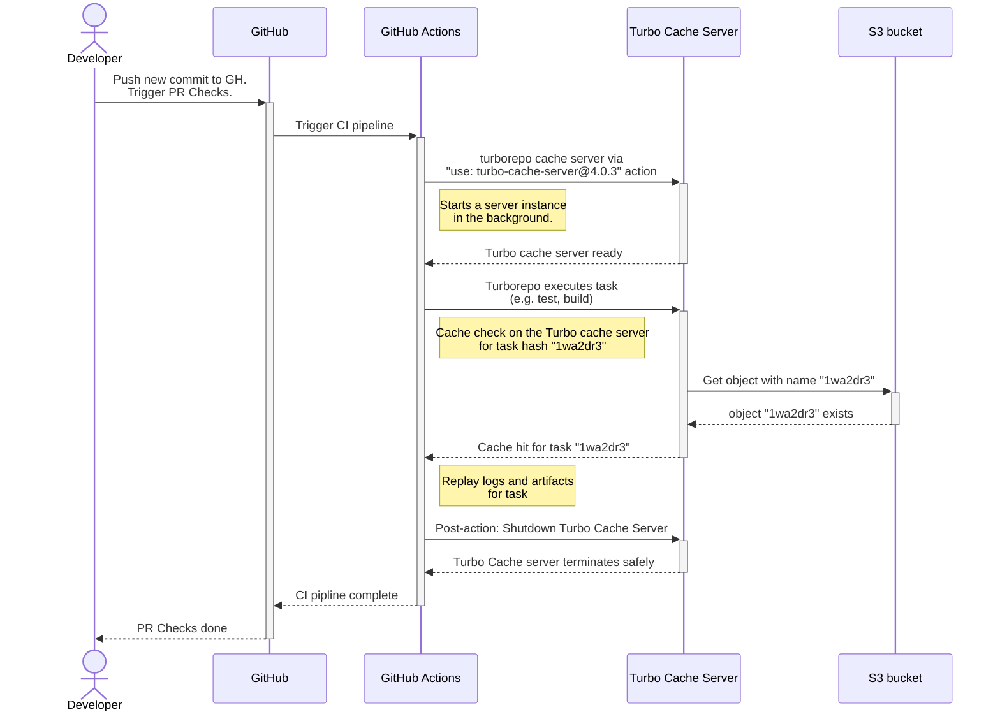
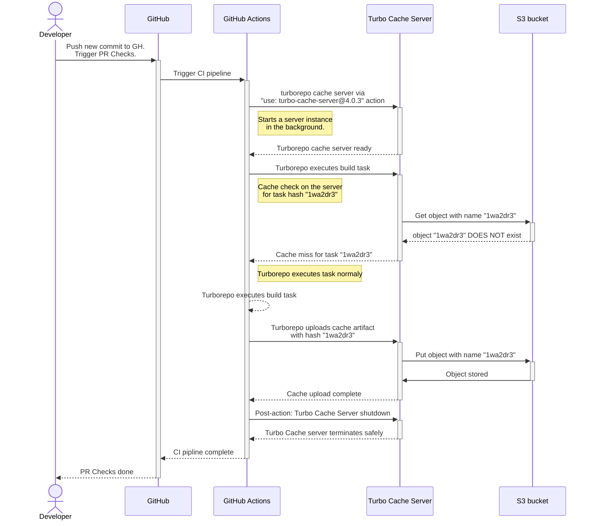

<p align="center"><br></p>
<h2 align="center">Multi-tenant Turborepo Remote Cache</h2>
<p align="center">
  One self-hosted, S3-backed <a href="https://turborepo.dev">Turborepo</a> remote cache, shared safely by many teams or projects: each one has its own token, and that token only reads and writes its own namespace.
</p>
<p align="center">
  A fork of <a href="https://github.com/brunojppb/turbo-cache-server">brunojppb/turbo-cache-server</a>.
</p>

The server speaks Turborepo's
[remote cache API](https://turborepo.dev/docs/core-concepts/remote-caching#self-hosting),
stores artifacts in any S3-compatible bucket, and runs as a container, a
plain binary or a GitHub Action. It is stateless, so it scales horizontally.

- [Why this fork](#why-this-fork)
- [Multi-tenancy: per-team tokens](#multi-tenancy-per-team-tokens)
- [Also supported: one shared token, or no authentication](#also-supported-one-shared-token-or-no-authentication)
- [Running it](#running-it): [GitHub Action](#github-action), [Docker](#docker), [Kubernetes](#deploying-to-kubernetes)
- [Releases and images](#releases-and-images)

## Why this fork

[brunojppb/turbo-cache-server](https://github.com/brunojppb/turbo-cache-server)
is a solid, small Turborepo cache server with one optional token shared by
every client. That fits one team. When several teams or projects share one
server, a shared token means every one of them can read, and overwrite,
everyone else's cache. This fork adds per-team tokens so one server can serve
them all safely, and publishes its own stable, signed releases.

Everything else stays compatible with upstream: the same environment
variables, the same behaviour when `TURBO_TOKENS_DIR` is unset, and the same
GitHub Action. The per-team tokens feature is proposed upstream; if it is
merged there, this fork will follow upstream again. Credit for the server
goes to [Bruno Paulino](https://github.com/brunojppb) and upstream's
contributors; the license is unchanged ([MIT](LICENSE)).

## Multi-tenancy: per-team tokens

### The problem

Turborepo sends its team (`TURBO_TEAM`) with every request, and the server
stores each artifact under that team's prefix in the bucket:
`<bucket>/<team>/<hash>`. With one shared `TURBO_TOKEN`, the team is just a
label the client picks. Any project holding the shared token can set another
team's `TURBO_TEAM` and:

- read that team's artifacts (build outputs, which may embed secrets or
  unreleased code);
- **poison** that team's cache: upload a crafted artifact under a hash the
  other team will request, and Turborepo restores it into their build.

Turborepo's artifact signing (`remoteCache.signature`) detects tampering only
if every team keeps its own signing key and turns it on. Per-team tokens stop
the cross-team access at the server.

### The model

- **A team is a namespace.** Its artifacts live under `<team>/` in the
  bucket. The team is the request's `slug` query parameter, else its
  `teamId`, the same value used for the storage key.
- **A token is bound to its team.** Each team has its own token. A request
  must carry the token of the team it names, or it is rejected before it
  reaches the bucket.
- **The server only holds hashes.** It reads `TURBO_TOKENS_DIR`: one file
  per team, the file name is the team, the content is the lowercase hex
  SHA-256 of that team's token. The tokens themselves live only with the
  teams that use them.

| Request | Response |
| --- | --- |
| No `Authorization: Bearer` header | `401` |
| Token that belongs to no team | `401` |
| Token of another team | `403` `{"error":"TURBO_TOKEN is not for this team"}` |
| Valid token, but the request names no team | `403` (there is no default namespace in this mode) |
| Token of the team the request names | handled as usual |

The check applies to every route under `/v8/artifacts`, including
`/v8/artifacts/status`. `GET /management/health` stays open for probes.

| Variable | Meaning |
| --- | --- |
| `TURBO_TOKENS_DIR` | Directory of per-team token hashes. Re-read every 10 seconds. |

`TURBO_TOKENS_DIR` and `TURBO_TOKEN` cannot be combined: with both set, the
server refuses to start. If the directory cannot be read at start, the server
refuses to start; if it becomes unreadable later, the server keeps the last
set it read and logs an error. Names starting with `.` are ignored
(Kubernetes keeps `..data` links in a mounted Secret), and so is a file whose
content is not a SHA-256 hex digest (with a warning in the log).

### Creating a token and its hash

Use a long random token: 32 random bytes is plenty.

```shell
TOKEN=$(openssl rand -base64 32 | tr '+/' '-_' | tr -d '=')
printf %s "$TOKEN" | sha256sum | cut -d' ' -f1
# on macOS: printf %s "$TOKEN" | shasum -a 256 | cut -d' ' -f1
```

`printf %s` matters: `echo` would add a newline to the hashed value. The hash
file may end with a newline; trailing whitespace is ignored.

Give the token to the team's CI as `TURBO_TOKEN`, with `TURBO_TEAM` set to
the team's name. Turborepo sends `TURBO_TEAM` as `slug` (as `teamId` when it
starts with `team_`); the file name must match it exactly, including case.

```shell
export TURBO_API="http://turbo-cache.example.internal:8000"
export TURBO_TEAM="web-app"
export TURBO_TOKEN="<the web-app token>"
```

Locally, a directory with one file per team is enough:

```shell
mkdir -p tokens
printf %s "$TOKEN" | sha256sum | cut -d' ' -f1 > tokens/web-app
TURBO_TOKENS_DIR=$PWD/tokens decay
```

### Setting it up in Kubernetes

Keep the hashes in a Secret, one key per team, and mount it as a directory.

```yaml
apiVersion: v1
kind: Secret
metadata:
  name: turbo-cache-tokens
type: Opaque
stringData:
  # key: the team (TURBO_TEAM); value: sha256 hex of that team's token
  web-app: "<sha256 hex of the web-app token>"
  api: "<sha256 hex of the api token>"
```

In the Deployment, mount it and point `TURBO_TOKENS_DIR` at it (and do not
set `TURBO_TOKEN`):

```yaml
      containers:
        - name: turbo-cache-server
          image: ghcr.io/13axis/turbo-cache-server:5.1
          env:
            - name: TURBO_TOKENS_DIR
              value: /etc/turbo-cache/tokens
            # S3_* variables as in "Deploying to Kubernetes" below
          volumeMounts:
            - name: tokens
              mountPath: /etc/turbo-cache/tokens
              readOnly: true
      volumes:
        - name: tokens
          secret:
            secretName: turbo-cache-tokens
```

Do not mount it with `subPath`: Kubernetes does not update `subPath` mounts,
so new teams would need a restart. The full Deployment, Service and probes are
in [Deploying to Kubernetes](#deploying-to-kubernetes).

### Adding or removing a tenant without a restart

Change the Secret; the kubelet updates the mounted files (usually within a
minute or two) and the server picks the change up within 10 seconds after
that.

```shell
# add or replace a team
kubectl patch secret turbo-cache-tokens --type merge \
  -p "{\"stringData\":{\"web-app\":\"$(printf %s "$TOKEN" | sha256sum | cut -d' ' -f1)\"}}"

# remove a team: its token stops working
kubectl patch secret turbo-cache-tokens --type json \
  -p '[{"op":"remove","path":"/data/web-app"}]'
```

Outside Kubernetes, write or delete the team's file in `TURBO_TOKENS_DIR`.
Write the new file next to it and rename it into place, so the server never
reads a half-written file (a malformed file is skipped until it is complete).

### Rotating a token

Create a new token, replace the team's hash with the new one's, then update
the team's CI secret. The old token stops working as soon as the server
reloads; jobs that are already running with it get `401` on their remaining
cache requests, which Turborepo treats as cache misses, so rotate when the
team's pipelines are quiet. Two teams may share a token if you want them to;
each still needs its own file.

### Cleaning up a tenant

Removing a team's file only revokes its token. Its artifacts stay in the
bucket under `<team>/`; delete that prefix to free the space:

```shell
aws s3 rm "s3://<bucket>/web-app/" --recursive
# S3-compatible stores: add --endpoint-url https://your-s3-endpoint
```

For routine cleanup of every tenant, set an expiration lifecycle rule on the
bucket (see [Managing Cache Storage with Lifecycle Rules](#managing-cache-storage-with-lifecycle-rules));
a rule with a `<team>/` prefix filter gives one tenant its own retention.

### Migrating from a shared `TURBO_TOKEN`

Artifacts are already stored per team, so nothing in the bucket moves.

1. List the teams in use: the top-level prefixes in the bucket
   (`aws s3 ls s3://<bucket>/`).
2. Create a token and hash for each team and write the hashes to the tokens
   directory or Secret.
3. Give each team its own token as `TURBO_TOKEN` in its CI. Until the server
   switches, it still accepts only the shared token, so keep the shared value
   until step 4 and switch each team's secret right after it.
4. On the server, remove `TURBO_TOKEN` and set `TURBO_TOKENS_DIR` (both set
   makes it refuse to start), then roll it out.
5. Artifacts under `no_team/` (requests without a team) are no longer
   reachable; delete that prefix.

A team without a file gets `403` from then on: that is how a forgotten
project shows up.

### Security notes

- The server stores unsalted SHA-256 hashes. That is safe for long random
  tokens like the ones above, not for passwords: never use a short or
  memorable token.
- Tokens are compared in constant time, against every team's hash.
- Isolation is enforced by the server, not by the bucket: the server's S3
  credentials can reach every team's prefix. Keep those credentials, and the
  bucket, out of the teams' reach.
- Keep the tokens directory readable only by the server. It holds hashes,
  not tokens, but there is no reason to share it.
- Tokens travel in an HTTP header. Use TLS whenever the cache is reached over
  a network you do not fully control.
- Team names are case-sensitive, and a team name cannot contain `/` or `\`
  or be `.` or `..`.
- Per-team tokens control who may read and write each namespace. They do not
  sign artifacts: turn on Turborepo's `remoteCache.signature` as well if you
  want clients to verify what they restore.

## Also supported: one shared token, or no authentication

Without `TURBO_TOKENS_DIR`, the server behaves exactly like upstream.

### One shared token (`TURBO_TOKEN`)

The server runs **without authentication by default**. This is an
intentional design decision: in the vast majority of deployments the server
sits behind a private network (a VPC, a Kubernetes cluster, or a GitHub
Actions runner) where only trusted sources can reach it, and requiring a
shared token adds overhead without a meaningful security benefit.

To enable authentication, set the `TURBO_TOKEN` environment variable on the
server. When set, every incoming request must include an
`Authorization: Bearer <TURBO_TOKEN>` header or it will be rejected with
`401 Unauthorized`. Turborepo clients read their own `TURBO_TOKEN` env var
and send this header automatically, so the server-side and client-side
values must match.

The server reads the `Bearer` scheme in any case, as HTTP requires. It
compares the token itself in constant time, so the time a rejection takes
does not tell an attacker how much of a guess was correct. A rejected
request returns a JSON body that says whether the header was missing or the
token was wrong:

```json
{ "error": "Invalid TURBO_TOKEN" }
```

When `TURBO_TOKEN` is unset on the server, the authentication middleware is
bypassed entirely and any `Authorization` header on incoming requests is
ignored.

> [!TIP]
> If you expose the cache server to the public internet, or to networks you
> do not fully control, set `TURBO_TOKEN` on the server. If more than one team
> or project uses the server, use [per-team tokens](#multi-tenancy-per-team-tokens)
> instead.

## Running it

### GitHub Action

Make sure that you have an S3-compatible storage available. We currently tested
with:

- [Amazon S3](https://aws.amazon.com/s3/)
- [Cloudflare R2](https://www.cloudflare.com/en-gb/developer-platform/r2/)
- [RustFS](https://github.com/rustfs/rustfs)

The GitHub Action supports both **Linux** (`x64` and `arm64`) and **macOS Apple Silicon** (`arm64` only; Intel macOS is no longer supported) runners. Here is how to use it:

1.  In your workflow files, add the following global environment variables:

    ```yml
    env:
      TURBO_API: "http://127.0.0.1:8585"
      TURBO_TEAM: "NAME_OF_YOUR_REPO_HERE"
      # TURBO_TOKEN is required by Turborepo to enable remote caching.
      # The cache server only validates it when TURBO_TOKEN is also set
      # on the server itself — otherwise the server accepts any value.
      # See "Also supported: one shared token, or no authentication" above.
      TURBO_TOKEN: "secret-turbo-token"
    ```

1.  In the same workflow file, after checking out your code,
    start the Turbo Cache Server in the background:

    ````yml
        - name: Checkout repository
          uses: actions/checkout@3d3c42e5aac5ba805825da76410c181273ba90b1 # v7.0.1

        - name: Turborepo Cache Server
          # Pin the action to a release commit SHA; keep its version in the comment.
          # The binaries are only committed on release tags, not on main, so
          # pick a release here:
          # https://github.com/13axis/turbo-cache-server/releases
          uses: 13axis/turbo-cache-server@<release commit sha> # v5.1.0
          env:
            PORT: "8585"
            S3_BUCKET_NAME: your-bucket-name-here
            # Region defaults to "eu-central-1"
            S3_REGION: "eu-central-1"
            # Optional: If you need to provide specific auth keys, separate from default AWS credentials
            S3_ACCESS_KEY: ${{ secrets.S3_ACCESS_KEY }}
            S3_SECRET_KEY: ${{ secrets.S3_SECRET_KEY }}
            # Optional: If not using AWS, provide endpoint like `https://rustfs` for your instance.
            S3_ENDPOINT: ${{ secrets.S3_ENDPOINT }}
            # Optional: If your S3-compatible store does not support requests
            # like https://bucket.hostname.domain/. Setting `S3_USE_PATH_STYLE`
            # to true configures the S3 client to make requests like
            # https://hostname.domain/bucket instead.
            # Defaults to "false"
            S3_USE_PATH_STYLE: false
            # Optional: Enable server-side encryption for stored artifacts.
            # Valid values: AES256, aws:kms, aws:kms:dsse, aws:fsx
            S3_SERVER_SIDE_ENCRYPTION: "AES256"

        # Now you can run your turborepo tasks and rely on the cache server
        # available in the background to provide previously built artifacts (cache hits)
        # and let Turborepo upload new artifacts when there is a cache miss.
        - name: Run tasks
          run: turbo run test build typecheck
        ```
    ````

The Action runs one server for one workflow, so it does not need per-team
tokens; they are for a server that many projects share.

And that is all you need to use the remote cache server for Turborepo. As a
reference, take a look at
[this example workflow file](https://github.com/brunojppb/turbo-decay/blob/main/.github/workflows/ci.yml)
for inspiration.

> [!NOTE]
> These environment variables are required by Turborepo so it can call
> the Turbo Cache Server with the right HTTP body, headers and query strings.
> These environment variables are necessary so the Turborepo binary can identify
> the Remote Cache feature is enabled and can use them across all steps. You can
> [read more about this here](https://turbo.build/repo/docs/ci#setup) on the
> Turborepo official docs.

### Docker

For folks using Gitlab or any other CI environment that supports Docker,
you can run the Turbo Cache Server as a docker container:

TURBO_TOKENS_DIR and its volume are optional: per-team tokens, see
[Multi-tenancy](#multi-tenancy-per-team-tokens). Use `-e TURBO_TOKEN=...`
instead for one shared token, or neither for no authentication.

```shell
docker run \
  -e S3_ACCESS_KEY=KEY \
  -e S3_SECRET_KEY=SECRET \
  -e S3_BUCKET_NAME=my_cache_bucket \
  -e S3_ENDPOINT=https://s3_endpoint_here \
  -e S3_REGION=eu \
  -e S3_SERVER_SIDE_ENCRYPTION=AES256 \
  -e TURBO_TOKENS_DIR=/etc/turbo-cache/tokens \
  -v "$PWD/tokens:/etc/turbo-cache/tokens:ro" \
  -p "8000:8000" \
  ghcr.io/13axis/turbo-cache-server:5.1
```

## Deploying to Kubernetes

Turbo Cache Server is a cloud-native, stateless application that runs seamlessly in Kubernetes environments. This makes it ideal for horizontally scaled deployments across multiple pods.

### Prerequisites

- A Kubernetes cluster (v1.20 or higher recommended)
- `kubectl` configured to access your cluster
- An S3-compatible storage bucket configured
- S3 credentials stored as Kubernetes secrets

### Minimal Deployment Configuration

Below is a minimal setup to deploy Turbo Cache Server to your Kubernetes cluster:

#### 1. Create a Secret for S3 Credentials

```yaml
apiVersion: v1
kind: Secret
metadata:
  name: turbo-cache-s3-credentials
  namespace: default
type: Opaque
stringData:
  S3_ACCESS_KEY: "your-access-key-here"
  S3_SECRET_KEY: "your-secret-key-here"
  # Optional: one shared token. For several teams, leave it out and use
  # per-team tokens instead (see "Setting it up in Kubernetes" above).
  TURBO_TOKEN: "secret-turbo-token"
```

Apply the secret:

```shell
kubectl apply -f turbo-cache-secret.yaml
```

#### 2. Create a Deployment

```yaml
apiVersion: apps/v1
kind: Deployment
metadata:
  name: turbo-cache-server
  namespace: default
spec:
  replicas: 2 # Scale horizontally as needed
  selector:
    matchLabels:
      app: turbo-cache-server
  template:
    metadata:
      labels:
        app: turbo-cache-server
    spec:
      containers:
        - name: turbo-cache-server
          image: ghcr.io/13axis/turbo-cache-server:5.1
          ports:
            - containerPort: 8000
              name: http
          env:
            - name: PORT
              value: "8000"
            - name: S3_BUCKET_NAME
              value: "your-bucket-name-here"
            - name: S3_REGION
              value: "eu-central-1"
            - name: S3_ACCESS_KEY
              valueFrom:
                secretKeyRef:
                  name: turbo-cache-s3-credentials
                  key: S3_ACCESS_KEY
            - name: S3_SECRET_KEY
              valueFrom:
                secretKeyRef:
                  name: turbo-cache-s3-credentials
                  key: S3_SECRET_KEY
            # Optional: only needed when authentication is enabled.
            - name: TURBO_TOKEN
              valueFrom:
                secretKeyRef:
                  name: turbo-cache-s3-credentials
                  key: TURBO_TOKEN
            - name: S3_ENDPOINT
              value: "https://your-s3-endpoint.com"
            - name: S3_SERVER_SIDE_ENCRYPTION
              value: "AES256"
          resources:
            requests:
              memory: "128Mi"
              cpu: "100m"
            limits:
              memory: "256Mi"
              cpu: "500m"
          livenessProbe:
            httpGet:
              path: /management/health
              port: 8000
            initialDelaySeconds: 10
            periodSeconds: 10
          readinessProbe:
            httpGet:
              path: /management/health
              port: 8000
            initialDelaySeconds: 5
            periodSeconds: 5
```

Apply the deployment:

```shell
kubectl apply -f turbo-cache-deployment.yaml
```

#### 3. Create a Service

```yaml
apiVersion: v1
kind: Service
metadata:
  name: turbo-cache-server
  namespace: default
spec:
  selector:
    app: turbo-cache-server
  ports:
    - protocol: TCP
      port: 8000
      targetPort: 8000
  type: ClusterIP
```

Apply the service:

```shell
kubectl apply -f turbo-cache-service.yaml
```

Artifacts are uploaded to S3 using streaming rather than full in-memory buffering. There is no server-side setting for enforcing payload size, so size limits should be enforced by your reverse proxy, ingress, load balancer, or storage policy if you need them.

#### 4. (Optional) Create an Ingress

If you need to expose the service externally:

```yaml
apiVersion: networking.k8s.io/v1
kind: Ingress
metadata:
  name: turbo-cache-ingress
  namespace: default
  annotations:
    # Configure based on your ingress controller
    # nginx.ingress.kubernetes.io/rewrite-target: /
spec:
  rules:
    - host: turbo.yourdomain.com
      http:
        paths:
          - path: /
            pathType: Prefix
            backend:
              service:
                name: turbo-cache-server
                port:
                  number: 8000
```

Apply the ingress:

```shell
kubectl apply -f turbo-cache-ingress.yaml
```

### Configuring Turborepo

Once deployed, configure your Turborepo clients to use the Kubernetes service:

```shell
export TURBO_API="http://turbo-cache-server.default.svc.cluster.local:8000"
export TURBO_TEAM="your-team-name"
export TURBO_TOKEN="secret-turbo-token"
```

For external access through ingress:

```shell
export TURBO_API="https://turbo.yourdomain.com"
export TURBO_TEAM="your-team-name"
export TURBO_TOKEN="secret-turbo-token"
```

## Managing Cache Storage with Lifecycle Rules

As your cache grows over time, you may want to automatically expire old cache entries to control storage usage and costs. Since Turbo Cache Server uses S3-compatible storage, you can configure bucket lifecycle rules to automatically delete objects after a specified period.

> [!NOTE]
> Lifecycle rules are configured at the S3 bucket level, not within the Turbo Cache Server itself. This allows you to manage storage independently of the cache server configuration.

### Setting up Object Expiration

Object expiration is based on the last modified time of objects in your bucket. You can configure expiration in two ways:

- **Days**: Objects will be deleted after a specified number of days (most common for a long running cache-server)
- **Date**: Objects will be deleted on a specific date

### AWS S3 and S3-Compatible Providers

For AWS S3, Cloudflare R2, RustFS, and other S3-compatible providers, you can use the AWS CLI to configure lifecycle rules.

#### Expire objects after 30 days

Create a JSON file named `lifecycle.json` with the following content:

```json
{
  "Rules": [
    {
      "Status": "Enabled",
      "Expiration": {
        "Days": 30
      }
    }
  ]
}
```

Then apply the lifecycle configuration to your bucket:

```shell
aws s3api put-bucket-lifecycle-configuration \
  --bucket your-bucket-name \
  --lifecycle-configuration file://lifecycle.json
```

#### Expire objects on a specific date

You can also set a specific expiration date:

```json
{
  "Rules": [
    {
      "Status": "Enabled",
      "Expiration": {
        "Date": "2025-12-31T00:00:00Z"
      }
    }
  ]
}
```

### Provider-Specific Notes

- **AWS S3**: Full lifecycle management support. See the [AWS S3 Lifecycle documentation](https://docs.aws.amazon.com/AmazonS3/latest/userguide/lifecycle-expire-general-considerations.html) for advanced options like transitioning to different storage classes.
- **Cloudflare R2**: Supports S3-compatible lifecycle API. Use the same AWS CLI commands with your R2 endpoint.
- **Tigris**: Supports object expiration via lifecycle rules. See the [Tigris object expiration documentation](https://www.tigrisdata.com/docs/buckets/objects-expiration/) for details.
- **RustFS**: Use the AWS CLI with your RustFS endpoint when your deployment exposes the S3 lifecycle APIs.

### Important Considerations

- **Lifecycle rules apply to all objects** in the bucket. If you're using the bucket for other purposes, consider using a dedicated bucket for cache storage or add filters to your lifecycle rules.
- **Expiration is asynchronous**: There may be a delay between the expiration date and when objects are actually removed.
- **Versioning**: If your bucket has versioning enabled, expiration rules apply only to current object versions. You may need separate rules for noncurrent versions.

## OpenTelemetry Support

Turbo Cache Server includes built-in support for [OpenTelemetry](https://opentelemetry.io/), providing distributed tracing and metrics collection out of the box. This enables you to monitor your cache server's performance and troubleshoot issues using industry-standard observability tools.

### Features

- **Distributed Tracing**: Track request flows through your cache server with detailed span data
- **Metrics Collection**: Monitor performance metrics like request rates, latencies, and cache hit/miss ratios
- **OTLP Export**: Supports both gRPC and HTTP protocols for exporting telemetry data
- **Industry Standard**: Compatible with any OpenTelemetry-compliant backend

### Service Identification

By default, all traces and metrics are tagged with the service name **`decay`** (the internal Rust crate name). You'll see this identifier in your observability platform when filtering or querying telemetry data. To use a different identifier, set the [`OTEL_SERVICE_NAME`](https://opentelemetry.io/docs/specs/otel/configuration/sdk-environment-variables/#general-sdk-configuration) environment variable:

```shell
export OTEL_SERVICE_NAME="turbo-cache-server"
```

### Supported Platforms

The OpenTelemetry integration works with all major observability SaaS platforms and open-source tools:

- **Commercial Platforms**: [Datadog](https://www.datadoghq.com/), [New Relic](https://newrelic.com/), [Honeycomb](https://www.honeycomb.io/), [Lightstep](https://lightstep.com/), [Dynatrace](https://www.dynatrace.com/)
- **Open Source**: [Jaeger](https://www.jaegertracing.io/), [Prometheus](https://prometheus.io/), [Grafana Tempo](https://grafana.com/oss/tempo/), [Zipkin](https://zipkin.io/)

### Disabling OpenTelemetry

If you don't need telemetry, you can disable the OpenTelemetry SDK entirely by setting the `OTEL_SDK_DISABLED` environment variable to `true`. This follows the [OpenTelemetry specification](https://opentelemetry.io/docs/specs/otel/configuration/sdk-environment-variables/#general-sdk-configuration) for disabling the SDK.

```shell
export OTEL_SDK_DISABLED="true"
```

When disabled, no OTLP exporters or system metric collectors will be initialized, and no connections will be attempted to any collector endpoint. Standard console and file logging will continue to work normally.

### Configuration

To enable OpenTelemetry export, set the following environment variables:

```shell
# OTLP endpoint (gRPC by default)
export OTEL_EXPORTER_OTLP_ENDPOINT="http://localhost:4317"

# Or use HTTP protocol
export OTEL_EXPORTER_OTLP_PROTOCOL="http/protobuf"
export OTEL_EXPORTER_OTLP_ENDPOINT="http://localhost:4318"

# Optional: override the service name reported to your
# observability platform (defaults to "decay")
export OTEL_SERVICE_NAME="turbo-cache-server"
```

For platform-specific configurations:

#### Datadog

```shell
export OTEL_EXPORTER_OTLP_ENDPOINT="https://api.datadoghq.com"
export OTEL_EXPORTER_OTLP_HEADERS="dd-api-key=<your-api-key>"
```

#### Honeycomb

```shell
export OTEL_EXPORTER_OTLP_ENDPOINT="https://api.honeycomb.io"
export OTEL_EXPORTER_OTLP_HEADERS="x-honeycomb-team=<your-api-key>"
```

### Local Development

For local testing, you can use the provided Docker Compose setup that includes RustFS, Jaeger, and Prometheus:

```shell
docker-compose -f docker-compose.otel.yml up
```

This starts:
- **RustFS API**: http://localhost:9000
- **RustFS Console**: http://localhost:9001
- **Jaeger UI**: http://localhost:16686 (trace visualization)
- **Prometheus**: http://localhost:9090 (metrics storage and queries)
- **OpenTelemetry Collector**: Receives and routes telemetry data

Then run your cache server with:

```shell
export OTEL_EXPORTER_OTLP_ENDPOINT="http://localhost:4317"
cargo run
```

Visit Jaeger to see distributed traces and Prometheus to query metrics from your local cache server.

## How does that work?

Turbo Cache Server is a tiny web server written in
[Rust](https://www.rust-lang.org/) that uses any S3-compatible bucket as its
storage layer for the artifacts generated by Turborepo.

### What happens when there is a cache hit?

Here is a diagram showing how the Turbo Cache Server works within our actions
during a cache hit:



### What happens when there is a cache miss?

When a cache isn't yet available, the Turbo Cache Server will handle new uploads
and store the artifacts in S3 as you can see in the following diagram:



## Development

Turbo Cache Server requires [Rust](https://www.rust-lang.org/) 1.75 or above. To
setup your environment, use the rustup script as recommended by the
[Rust docs](https://www.rust-lang.org/learn/get-started):

```shell
curl --proto '=https' --tlsv1.2 -sSf https://sh.rustup.rs | sh
```

Now run the following command to run the web server locally:

```shell
cargo run
```

### Setting up your environment

During local development, you might want to try the Turbo Dev Server locally
against a JS monorepo. As it depends on a S3-compatible service for storing
Turborepo artifacts, we recommend using [RustFS](https://github.com/rustfs/rustfs) with Docker
with the following command:

```shell
docker run -d \
  --name rustfs_container \
  -p 9000:9000 \
  -p 9001:9001 \
  -v $(pwd)/s3_data:/data \
  -v $(pwd)/s3_logs:/logs \
  -e RUSTFS_ACCESS_KEY=rustfsadmin \
  -e RUSTFS_SECRET_KEY=rustfsadmin \
  -e RUSTFS_CONSOLE_ENABLE=true \
  rustfs/rustfs:latest \
  --address :9000 \
  --console-enable \
  --access-key rustfsadmin \
  --secret-key rustfsadmin \
  /data
```

#### Setting up environment variables

Copy the `.env.example` file, rename it to `.env` and add the environment
variables required. As we use RustFS locally, open the
[Web UI](http://localhost:9001), create a bucket, and use `rustfsadmin` for
both `S3_ACCESS_KEY` and `S3_SECRET_KEY` in the `.env` file.

### Tests

To execute the test suite, run:

```shell
cargo test
```

While running our end-to-end tests, you might run into the following error:

```log
thread 'actix-server worker 9' panicked at /src/index.crates.io-6f17d22bba15001f/actix-server-2.4.0/src/worker.rs:404:34:
called `Result::unwrap()` on an `Err` value: Os { code: 24, kind: Uncategorized, message: "Too many open files" }
thread 'artifacts::list_team_artifacts_test' panicked at tests/e2e/artifacts.rs:81:29:
Failed to request /v8/artifacts
```

This is likely due the the maximum number of open file descriptors defined for
your user. Just run the following command to fix it:

```shell
ulimit -n 1024
```


## Releases and images

Releases follow [SemVer](https://semver.org) and are listed in
[CHANGELOG.md](CHANGELOG.md). Tags are `v<version>`; this fork's line
continues from upstream's 5.0.4 (see the changelog for the upstream version
each release is based on).

| Image tag | Moves |
| --- | --- |
| `ghcr.io/13axis/turbo-cache-server:5.1.0` | never |
| `ghcr.io/13axis/turbo-cache-server:5.1` | to each 5.1.x patch release |
| `ghcr.io/13axis/turbo-cache-server:latest` | to each stable release |

Images are multi-arch (`linux/amd64`, `linux/arm64`), built on `scratch`
with the static binary and CA certificates. Pin a digest in production. Each
release image carries:

- a CycloneDX SBOM per platform, attached to the image digest as an OCI 1.1
  referrer: `oras discover ghcr.io/13axis/turbo-cache-server@<digest>`. The
  binary is built with [cargo-auditable](https://github.com/rust-secure-code/cargo-auditable),
  so the SBOM lists the crates it contains;
- build provenance: `gh attestation verify oci://ghcr.io/13axis/turbo-cache-server@<digest> -R 13axis/turbo-cache-server`.

The GitHub release has static Linux binaries (x86-64, ARM64), a macOS Apple
Silicon binary, `SHA256SUMS`, the SBOMs, and provenance attestations for the
binaries.

## Building and releasing

`Dockerfile` is a standalone source build. For example:

```sh
docker build -t decay .
# Export just the executable for the Docker builder's native architecture:
docker buildx build --target artifact --output type=local,dest=out .
```

CI reads the Rust version from `rust-toolchain.toml`; keep the standalone
`RUST_VERSION` default in `Dockerfile` aligned when updating the toolchain.
Cross-platform source builds need a matching native builder or QEMU; release CI
uses native runners. `Dockerfile.release` is for packaging an already-built
`linux/amd64/decay` and `linux/arm64/decay` context, without compilation.

Workflows, kept to what is needed:

- `ci.yml`: format, lint and tests on every pull request.
- `build.yml`: the release build on pull requests that change packaging.
- `release.yml`, run by hand from `main` with a version (e.g. `5.1.0`): builds
  the static Linux AMD64 and ARM64 executables and the macOS ARM64 one in
  parallel on native runners, commits them on a release commit tagged
  `v<version>` (the GitHub Action runs the binaries in `action/`, which `main`
  does not carry), pushes the image with its SBOMs and provenance, and creates
  the GitHub release from the changelog entry.
- `snapshot.yml`, run by hand on any branch: an amd64 test image tagged
  `sha-<commit>`, with its SBOM, for trying a change before it is released.

To release: add the version's entry to `CHANGELOG.md` on `main`, then run
`release.yml` with that version.

Linux builds store Cargo Chef's intermediate dependency layers in GHCR under
`ghcr.io/<owner>/turbo-cache-server:buildcache-amd64` and `:buildcache-arm64`,
using BuildKit's registry cache with `mode=max`. Keep them excluded from
registry cleanup rules. Releases update the cache using `GITHUB_TOKEN` with
`packages: write`; pull request builds restore anonymously and never publish
caches. A missing cache causes a normal cold build.

macOS uses a separate GitHub Actions Cargo cache; it is subject to GitHub's
seven-day inactivity eviction and may rebuild dependencies after idle weeks.

See [the release build analysis](docs/release-build-research.md) (upstream's)
for measured timings, architecture alternatives, caching details, and sources.
